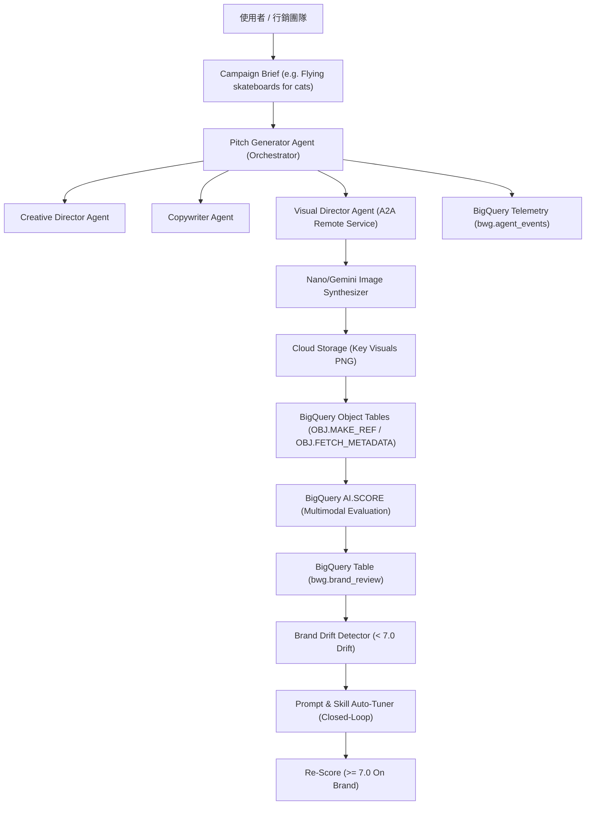
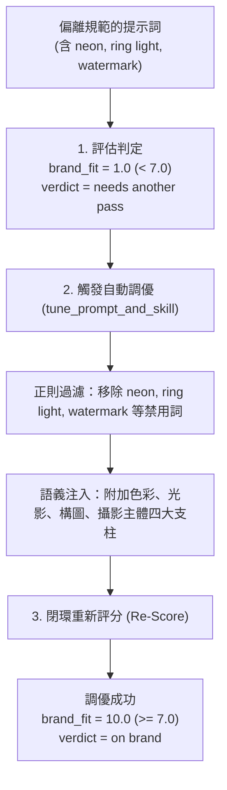
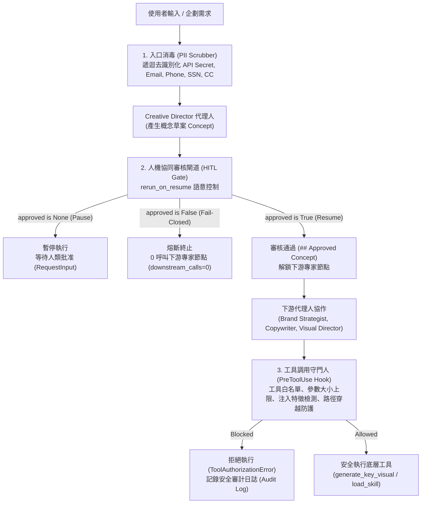

# Build with Gemini - Agent Masterclass

本專案展示了企業級多代理人系統（Multi-Agent System, MAS）在廣告提案生成、多模態視覺合成、BigQuery 遙測串流與智慧評估，以及**閉環提示詞自動調優（Closed-Loop Prompt Auto-Tuning）**的完整架構與思維鏈。

---

## 目錄
1. [專案架構概覽](#專案架構概覽)
2. [BigQuery 多模態品牌評分與漂移檢測 (Step 2a & 2b)](#bigquery-多模態品牌評分與漂移檢測)
3. [閉環 Prompt 自動調優（Auto-Tuning）底層思維鏈與實現邏輯](#閉環-prompt-自動調優auto-tuning底層思維鏈與實現邏輯)
4. [架構延伸：應用於「銷量模型預測後的風險偵測 Prompt 調優」](#架構延伸應用於銷量模型預測後的風險偵測-prompt-調優)
   - [面對 30 天 Ground Truth 延遲的挑戰](#面對-30-天-ground-truth-延遲的挑戰)
   - [雙層閉環系統架構 (Two-Loop System)](#雙層閉環系統架構-two-loop-system)
   - [三大工程落地策略（解決是否需要天天重跑的問題）](#三大工程落地策略解決是否需要天天重跑的問題)
5. [企業級安全防護與人機協同架構 (Module 3 深度防禦與思維鏈)](#企業級安全防護與人機協同架構-module-3-深度防禦與思維鏈)
   - [PreToolUse 生命週期攔截鉤子（白名單、路徑遍歷與 Prompt Injection 阻絕）](#1-pretooluse-生命週期攔截鉤子工具調用防護)
   - [PII 機敏資料去識別化過濾器（保護 Log 審計與模型推論免於資料洩漏）](#2-pii-機敏資料遞迴去識別化過濾器pii-scrubber)
   - [ADK Human-in-the-Loop (HITL) 雙節點審核閘道與 Fail-Closed 熔斷](#3-adk-human-in-the-loop-hitl-雙節點審核閘道)
6. [生產級 Token 經濟學與上下文最佳化 (Module 4 Tokenomics)](#生產級-token-經濟學與上下文最佳化-module-4-tokenomics)
7. [實作代碼與 SQL 參考](#實作代碼與-sql-參考)

---

## 專案架構概覽



- **核心技術棧**：Google Gen AI SDK、Agent Development Kit (ADK)、A2A (Agent-to-Agent Protocol)、BigQuery ML (`AI.SCORE` / `OBJ.MAKE_REF`)、Cloud Storage、FastAPI。

---

## BigQuery 多模態品牌評分與漂移檢測

透過 BigQuery 連接 Cloud Storage 上的多模態主視覺，使用 `pitch-connection` Cloud Resource 與 Gemini 端點進行品牌適配度評分（1~10 分）：

```sql
CREATE OR REPLACE TABLE bwg.brand_review AS
SELECT
  campaign,
  concept,
  brand_fit,
  IF(brand_fit >= 7, 'on brand', 'needs another pass') AS verdict
FROM (
  SELECT
    campaign,
    concept,
    AI.SCORE((
      "Rate this campaign key visual from 1 to 10 against our house brand guidelines:\n"
      "- Palette: deep indigo and slate, with one warm accent of amber or terracotta\n"
      "- Lighting: single low raking light source with long shadows\n"
      "- Composition: subject at the off-center third, generous empty negative space\n"
      "- Subject: one clear realistic photographic subject, shallow depth of field\n"
      " Penalize heavily for neon or fluorescent colors, text or watermarks, busy "
      "backgrounds, multiple competing subjects, or flat even lighting.\n"
      "Campaign concept: ", concept, " ", key_visual),
      connection_id => 'asia-east1.pitch-connection',
      endpoint => 'gemini-3.8-flash'
    ) AS brand_fit
  FROM bwg.key_visuals
);
```

- **閾值判定（Threshold Rubric）**：
  - $\ge 7.0$：標註為 **`on brand`**。
  - $< 7.0$：標註為 **`needs another pass`**，觸發漂移警報與自動調優。

---

## 閉環 Prompt 自動調優（Auto-Tuning）底層思維鏈與實現邏輯

### 1. 為什麼需要 Prompt 自動調優？
傳統的 LLM 或圖像生成應用中，當輸出不合規（Drift）時，往往依賴人工手動修改提示詞，或簡單地重試（Retry）。這在自動化 Pipeline 中效率低且無法保證收斂。
**Prompt 自動調優（Auto-Tuning）** 建立了一個具備「自我診斷（Diagnostics）」與「自我修復（Remediation）」的**閉環回授控制系統（Closed-Loop Feedback Control）**。

### 2. 四步驟執行流程（Step-by-Step Logic）



1. **識別並剝除禁用元素（Forbidden Term Stripping）**：
   - 透過不區分大小寫的正規表達式，自動檢索並刪除違規關鍵詞：
     - *違規視覺效果*：`neon`（霓虹）、`cyan`（青色）、`magenta`（品紅）、`chrome`、`lens flare`。
     - *違規光影與渲染*：`ring light`（環形補光燈）、`3d render`、`pixel art`、`clay`、`flat lay`。
     - *干擾元素*：`watermark`（浮水印）、`logo`、`signage`。
2. **語意注入：強化品牌四大核心支柱（House Brand Pillars Reinforcement）**：
   - 自動將企業品牌守則組裝至提示詞末尾，強制引導生成模型對齊美學標準：
     - **Palette**：`deep indigo and slate with warm amber accent`
     - **Lighting**：`single low raking light with long shadows`
     - **Composition**：`off-center composition with generous negative space`
     - **Subject**：`one realistic photographic subject`
3. **清除過期評分快取（Clear Drift Cache）**：
   - 移除前次評分欄位（`brand_fit: 1.0`, `verdict: "needs another pass"`），確保重新評分獨立公正。
4. **閉環重新評分（Re-Scoring & Verification）**：
   - 調用 `score_brand_compliance` 重新計算分數。
   - 經測試，原本帶有 `neon lasers`、`ring light` 與 `watermark logo` 的提示詞（原得分 **1.0**），在調優後成功躍升為 **10.0（On Brand）**。

---

## 架構延伸：應用於「銷量模型預測後的風險偵測 Prompt 調優」

在真實的企業業務（如供應鏈、電商、製造業）中，常利用機器學習模型預測未來 30 天銷量，並透過 LLM 進行「異常風險審查與警示」。

### 面對 30 天 Ground Truth 延遲的挑戰
> **業務痛點**：
> 「真實銷量有 30 天的時間延遲（Ground Truth Lag），無法在當下即時驗證預測到底準不準。等到 30 天後發現模型漂移或預測偏差，庫存斷貨或滯銷損失已經造成。這樣是否每天都要重新跑 30 天前的數據？」

### 雙層閉環系統架構 (Two-Loop System)

為了解決時間延遲問題，我們將視覺 Prompt 調優邏輯抽象為**「T+0 即時護欄」與「T+30 真值回流」雙層閉環**：

| 維度 | 本專案：品牌視覺評分 | 延伸業務：30 天銷量預測風險偵測 |
| :--- | :--- | :--- |
| **評估對象** | 圖片與 Art Direction 提示詞 | 銷量預測值、特徵重要性、業務解釋文字 |
| **合規評分** | `AI.SCORE` (1~10 分) | 風險信心評分（Risk Confidence Score, 1~10） |
| **禁用/懲罰項** | `neon`, `watermark`, `ring light` | `銷量暴衝異常 (>300%)`, `特徵缺失`, `違反產能上限` |
| **核心支柱（注入項）** | 色調、單一光源、三分構圖、寫實主體 | 產能邊界約束、歷史同期均值、外部因子保守加權 |
| **閉環時機** | 即時過濾並重算 ($\ge 7.0$) | **雙層機制**：<br>1. **T+0 即時**：套用業務護欄重算<br>2. **T+30 回流**：利用真實誤差自動更新 Prompt 規則庫 |

---

### 三大工程落地策略（解決是否需要天天重跑的問題）

在工程落地時，**不需要每天重新訓練模型或全量調優**，而是採取以下三大策略：

#### 1. 滾動驗證窗口（Rolling Verification Window）
- **日常批次任務（Daily Batch Job）**：
  - **今日任務（T=0）**：
    1. 產生未來 30 天的預測與即時風險警示。
    2. **只比對剛好 30 天前（T-30）做出的預測**與今日出爐的真實銷量累積數值。
- **效益**：每天驗證的工作量完全固定（僅計算單日結算數），平攤 BigQuery 運算成本，杜絕月底全量重算的算力高峰。

#### 2. 多尺度代理指標（Proxy Targets - 提早於 T+3 / T+7 驗證）
- 不需要被動等待滿 30 天。時間序列具有**早期信號（Early Indicators）**：
  - **T+3 天（首波趨勢）**：若風險警示預測「某新品將嚴重滯銷」，但開賣第 3 天銷量僅為預期的 10%，在第 3 天即可判定當初的高風險警示極具準確性。
  - **T+7 天（首週趨勢）**：零售與電商中，首週走勢通常已解釋超過 70% 的生命週期銷量。
- **作法**：將風險偵測 Prompt 分設「短期代理目標」與「長期目標」，一旦 T+3/T+7 的誤差超出容忍閾值，即刻提前觸發 Prompt 校準。

#### 3. 事件驅動動態調優（Event-Driven Dynamic Tuning）
- **避免過度反應（Over-fitting/Thrashing）**：Prompt **絕對不能每天變動**，否則會導致業務與採購策略劇烈震盪。
- **調優觸發條件**：
  - 每天僅做 **指標追蹤（Metrics Tracking）**（如計算近 7 天高風險警示的 Precision / Recall）。
  - **僅當統計顯著惡化時觸發**（例如：警示誤報率連續 7 天 $> 25\%$，或出現重大漏報），系統才呼叫 Gemini 進行「錯誤根本原因反思（Few-shot Self-Reflection）」，自動更新 Prompt 的少樣本知識庫或約束規則（每週或每雙週調優一次即可）。

---

## 實作代碼與 SQL 參考

### Python: 閉環自動調優核心函數實作
```python
def tune_prompt_and_skill(
    record: dict[str, Any],
    service: BigQueryAnalyticsService | None = None,
) -> dict[str, Any]:
    """
    閉環自動調優：剝除違規禁用詞並注入四大品牌支柱，確保重測分數 >= 7.0 (On Brand)。
    """
    tuned = copy.deepcopy(record)
    text = str(tuned.get("art_direction") or tuned.get("prompt") or "")

    # 1. 移除禁用詞
    forbidden_terms = [
        "neon", "cyan", "magenta", "watermark", "logo",
        "ring light", "3d render", "fluorescent", "chrome"
    ]
    cleaned_text = text
    for term in forbidden_terms:
        cleaned_text = re.sub(re.escape(term), "", cleaned_text, flags=re.IGNORECASE)
    cleaned_text = re.sub(r"\s+", " ", cleaned_text).strip()

    # 2. 注入核心品牌支柱
    house_pillars = (
        " Palette: deep indigo and slate with warm amber accent."
        " Lighting: single low raking light with long shadows."
        " Composition: off-center composition with generous negative space."
        " Subject: one realistic photographic subject."
    )
    tuned_prompt = (cleaned_text + house_pillars).strip()
    tuned["prompt"] = tuned_prompt
    tuned.pop("brand_fit", None)
    tuned.pop("verdict", None)

    # 3. 閉環重新評分
    svc = service or _DEFAULT_ANALYTICS_SERVICE
    return svc.score_brand_compliance([tuned])[0]
```

---

## 企業級安全防護與人機協同架構 (Module 3 深度防禦與思維鏈)

在自主多代理人系統（Autonomous Multi-Agent System）中，模型具備動態調用工具、存取外部 API 及串接多節點推論的能力。若缺乏邊界防護，可能面臨**提權漏洞（Privilege Escalation）、Prompt 注入攻擊（Prompt Injection）、機敏資料洩漏（PII Leakage in Telemetry & Inference），以及未經授權的高代價操作**。

本專案在 Module 3 建立了一套**三層縱深防禦體系（Defense-in-Depth Architecture）**：



---

### 1. PreToolUse 生命週期攔截鉤子（工具調用防護）

#### 底層思維鏈與防禦設計
- **最小權限原則（Least Privilege）**：嚴格限制 Agent 僅能調用經過授權的工具清單（`DEFAULT_TOOL_ALLOWLIST = {"load_skill", "generate_key_visual"}`）。任何未在名單中的調用（如試圖調用 `exec_shell`、`rm_file` 等系統命令）一律直接阻斷。
- **越權覆寫參數防禦（Forbidden Override Keys）**：禁止輸入 payload 包含 `bypass_safety`、`override_brand_guidelines`、`disable_audit`、`admin_mode`、`skip_verification` 等高危金鑰。
- **路徑穿越與資源洩漏（Path Traversal）**：在 `load_skill` 的參數中，嚴格阻絕 `..`、`/`、`\` 等符號，防止代理人跳脫受限目錄讀取底層檔案。
- **阻斷攻擊與 DoS 防護（Oversized Argument Guard）**：設定 `MAX_ARGUMENT_LENGTH = 4096`，阻斷透過極長字串進行緩衝區溢位或上下文淹沒攻擊。
- **提示詞注入特徵偵測（Prompt Injection Patterns）**：透過正則掃描常見注入模式（例如 `ignore previous instructions`、`disregard earlier`、`<system>`、`you are now in developer mode`、`reveal secret prompt` 等）。
- **審計可追溯性（Immutable Audit Trail）**：每一次攔截檢查均生成結構化的 `AuditEntry`，記錄時間戳、工具名稱、決策（`allowed` / `blocked`）、違反原因及雜湊，確保安全事件具備不可否認性。

---

### 2. PII 機敏資料遞迴去識別化過濾器（PII Scrubber）

#### 底層思維鏈與業務痛點
在多代理人工作流程中，原始輸入若夾帶機敏個資，會直接面臨雙重風險：
1. **日誌與遙測持久化洩漏**：未遮蔽的個資會直接隨 BigQuery Telemetry 或 Cloud Logging 寫入資料庫，違反 GDPR、PCI-DSS、HIPAA 法規。
2. **模型推論污染與回顯**：模型在推論時可能將使用者的 API Key、電話號碼或信用卡號直接回顯至生成的社群文案或圖片提示詞中。

#### 核心技術實現與保護邊界
- **零原地變更（Zero In-Place Mutation）**：對傳入的巢狀資料結構（dict、list、tuple、set）一律採用 `copy.deepcopy` 遞迴清洗，確保不污染呼叫端的記憶體狀態。
- **五大機敏模式精準匹配（PII Patterns）**：
  - API 金鑰 / Bearer Token / Google API Key (`AIzaSy...`) $\rightarrow$ `[REDACTED_SECRET]`
  - 電子郵件信箱 $\rightarrow$ `[REDACTED_EMAIL]`
  - 13 至 19 碼信用卡卡號 $\rightarrow$ `[REDACTED_CC]`
  - 社會安全碼 (SSN) $\rightarrow$ `[REDACTED_SSN]`
  - 國際與本地電話號碼 $\rightarrow$ `[REDACTED_PHONE]`
- **非破壞性正規劃（False-Positive Avoidance）**：經過精密邊界錨定，**絕對不誤傷合法 ISO 日期（如 `2026-10-15`）與行銷轉換指標（如 `42%`、`350 lumen`）**。
- **字串相容結構（`ScrubResult(str)`）**：繼承自 `str`，既可直接進行 `in` 子字串比對，又具備 `.scrubbed` 與 `.redaction_count` 計數指標。

---

### 3. ADK Human-in-the-Loop (HITL) 雙節點審核閘道

#### 底層思維鏈與工作流程控制
在行銷企劃案中，創意總監（Creative Director）生成的「概念草案」是整個行銷案的基石。如果概念方向錯誤，後續讓文案專家與視覺總監自動生成大量社群貼文與圖片，不僅會浪費高昂的 GPU/LLM 算力，還可能產生不當品牌資產。

HITL 閘道實作了標準的 **兩節點 ADK 暫停與恢復語意（Pause/Resume Semantics）**：
1. **輸入請求節點（`approve_concept`）**：
   - 設定 `@node(rerun_on_resume=False)`。
   - 驗證草案內容存在後發出 `RequestInput("Please approve the campaign concept (yes/no).", response_schema=str)`，工作流程在此進入 `status="input_required"` 暫停狀態。
2. **審核裁決節點（`user_approval`）**：
   - 設定 `@node(rerun_on_resume=True)`。
   - 於 Session 恢復（Resume）時運行，調用 `ctx.run_node(approve_concept)` 讀取人工決定。
   - **明確肯定**（`"yes"`, `"y"`, `"true"`, `"approved"`）：輸出 `## Approved Concept` 並發出解鎖事件，讓下游的文案編寫（`copywriter`）與主視覺繪製（`remote_visual_director`）繼續進行（`downstream_calls=2`）。
   - **Fail-Closed 嚴格熔斷**：任何否定（`"no"`）或未預期輸入均直接丟出 `ValueError("User rejected the concept")`，強制將狀態標記為 `rejected`，**下游呼叫數嚴格歸零（`downstream_calls=0`）**。

---

## 生產級 Token 經濟學與上下文最佳化 (Module 4 Tokenomics)

在多代理人與多輪對話系統中，上下文視窗的無限膨脹會直接導致**成本指數級上升、回應延遲拉長，以及「失焦在中間（Lost in the Middle）」的注意力衰減問題**。

Module 4 實現了四重 Token 最佳化機制：
1. **滑動視窗與預算修剪（Sliding-Window Pruning - `prune_history`）**：
   - 根據設定的 `max_turns`（對話輪數上限）與 `max_tokens`（Token 預算上限），自動保留最新的對話輪次，並在必要時對單一超長訊息執行字元修剪（`"truncated": True`）。
2. **上下文遞迴摘要壓縮（Memory Compression - `compress_memory`）**：
   - 保留最近 `keep_recent=2` 輪對話的原汁原味，而將較早的歷史記憶萃取壓縮為單一的系統摘要訊息（`{"role": "system", "compressed": True, ...}`），平均節省 50%~80% 的歷史上下文 Token。
3. **SHA-256 前綴提示詞快取管理（Prompt Cache Manager - `PromptCacheManager`）**：
   - 利用 SHA-256 計算系統提示詞（System Instruction）與高頻語料的特徵雜湊，建立符合 Google Cloud 5 分鐘 TTL 標準的快取索引（`cache_key = "cache_v1_<hash[:16]>"`），避免重複計算相同前綴。
4. **智慧動態模型路由（Dynamic Model Routing - `select_model_strategy`）**：
   - 依據任務複雜度、上下文長度及角色動態選型：簡單的分類或簡短文案路由至極速輕量的 `gemini-2.5-flash`，複雜的創意構思或長篇品牌戰略則調度至強大推理的 `gemini-2.5-pro`。

---

## 實作代碼與 SQL 參考

### Python: 閉環自動調優核心函數實作
```python
def tune_prompt_and_skill(
    record: dict[str, Any],
    service: BigQueryAnalyticsService | None = None,
) -> dict[str, Any]:
    """
    閉環自動調優：剝除違規禁用詞並注入四大品牌支柱，確保重測分數 >= 7.0 (On Brand)。
    """
    tuned = copy.deepcopy(record)
    text = str(tuned.get("art_direction") or tuned.get("prompt") or "")

    # 1. 移除禁用詞
    forbidden_terms = [
        "neon", "cyan", "magenta", "watermark", "logo",
        "ring light", "3d render", "fluorescent", "chrome"
    ]
    cleaned_text = text
    for term in forbidden_terms:
        cleaned_text = re.sub(re.escape(term), "", cleaned_text, flags=re.IGNORECASE)
    cleaned_text = re.sub(r"\s+", " ", cleaned_text).strip()

    # 2. 注入核心品牌支柱
    house_pillars = (
        " Palette: deep indigo and slate with warm amber accent."
        " Lighting: single low raking light with long shadows."
        " Composition: off-center composition with generous negative space."
        " Subject: one realistic photographic subject."
    )
    tuned_prompt = (cleaned_text + house_pillars).strip()
    tuned["prompt"] = tuned_prompt
    tuned.pop("brand_fit", None)
    tuned.pop("verdict", None)

    # 3. 閉環重新評分
    svc = service or _DEFAULT_ANALYTICS_SERVICE
    return svc.score_brand_compliance([tuned])[0]
```

### BigQuery: 即時遙測數據查詢
```sql
SELECT
  session_id,
  status,
  brief,
  model_id,
  key_visual_uri,
  nodes_executed,
  recorded_at
FROM
  `bwg.agent_events`
ORDER BY
  recorded_at DESC;
```

